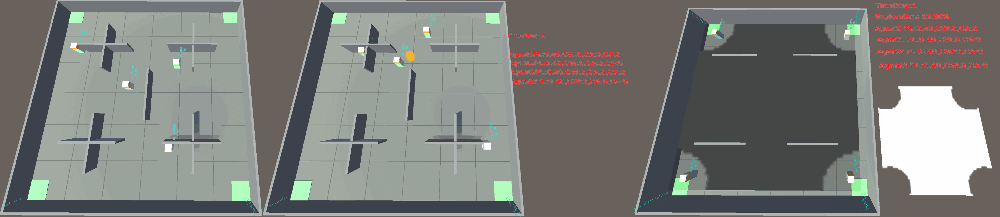

<h1 style="font-size: 20px">FHER: A Multi-agent Reinforcement Learning Benchmark for Fire Hazard-Aware Emerging Response</h1>
Ke ZHANG, Toshiharu SUGAWARA. FSE, Waseda University

## What is FHER 🧐?
FHER is a fire hazard–aware simulation environment designed for multi-agent reinforcement learning (MARL) research. It focuses on emergency response scenarios involving fire hazards, agent coordination, and human–agent interaction.
### 🧩 Task Types 
FHER consists of three categories of tasks, covering different stages and dynamics of fire emergency response:
1. Evacuation Drill: agents learn to adaptively select appropriate exits among multiple options and plan a shortest evacuation path.
2. Evacuation Guidance: agents learn to guide crowded to evacuate safely and efficiently under fire-related constraints.
3. Post-fire Search and Rescue: agents conduct indoor search and rescue operations after a fire.
### 🗺️ Maps and Scenarios

FHER provides five indoor maps, each with distinct spatial layouts and fire hazard distributions.
By combining the task types with the maps, FHER offers a total of 15 unique scenarios, enabling systematic evaluation of:

FHER use BenchMARL as its backend and use Unity ml-agents to develop various fire hazard-aware tasks, including multi-agent evacuation, exploration and pathfinding in static or dynamic envrionment.