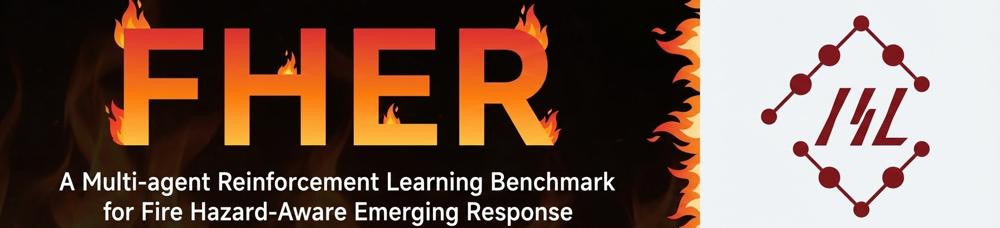
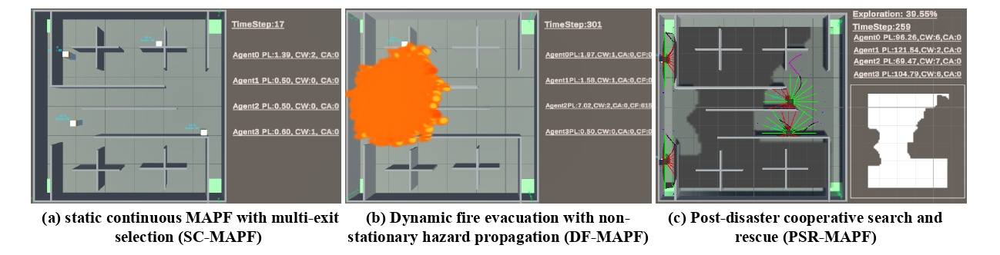
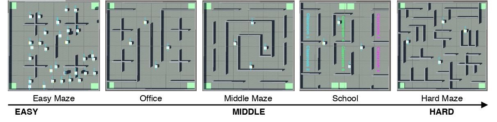

<h1 style="font-size: 20px">FHER: A Multi-agent Reinforcement Learning Benchmark for Fire Hazard-Aware Emerging Response</h1>
Ke ZHANG, FSE, Waseda University

<video src="https://github.com/user-attachments/assets/f1859419-4401-450c-9f48-7332fc96e3c8" width="100%" autoplay loop muted playsinline></video>

<!-- ## Demo 🚕

<video width="640" height="120" controls>
  <source src="https://github.com/ColaZhang22/FHER/raw/main/icon/Demo.mp4" type="video/mp4">.
</video> -->

## Overview 🧐
FHER is a fire hazard–aware simulation environment designed for multi-agent reinforcement learning (MARL) research. FHER consists of three categories of tasks, covering different stages and dynamics of fire emergency response:


1.  Static continuous MAPF with multi-exit selection (SC-MAPF)
2. Dynamic fire evacuation with non-stationary hazard propagation (DF-MAPF)
3. Post-disaster cooperative search and rescue (PSR-MAPF)
   
### 🗺️ Maps of FHER



## 🚀 Quick Start

1️⃣ Installation

```cmd
# Clone the repository
git clone https://github.com/ColaZhang22/FHER.git
cd FHER
```

```cmd
# Create conda environment
conda create -n FHER python=3.10 -y
conda activate FHER

pip install -r requirements.txt
```

2️⃣ Downlaod Maps and Add Path to Yaml file

Please download `maps` from the following link: [Google Drive](https://drive.google.com/drive/folders/1EAmEnp1boQkjtLMovZGJwWxcNdU3zXM2?usp=drive_link).

Open `benchmarl/conf/task/fheragent/xxx.yaml` and update the env_path field:
```yaml
env_path:  fill the downloaded env path
```

3️⃣ Launching the Training

🧩 Notes 
1. FHER currently supports only Windows systems with an NVIDIA GPU.
2. At least 4 GB of GPU memory is required.

```cmd
# Run a single task
python benchmarl/run.py 
    algorithm=ippo # mappo iddpg isac masac maddpg ippo
    task=fheragent/easy_maze_static
    experiment=fheragent/fheragenthard_experiment.yaml 
    seed=0

# Run mutiple tasks
.\run.bat     
```

##  ⚙️ Example Result


## 🪪 License
```cmd
This benchmark includes code from FHER,
licensed under the MIT License.
Copyright (c) 2025 ショウ カ
```

 Maintained by [Colazhang](https://github.com/ColaZhang22). Feedback, issues, and contributions are welcome via GitHub Discussions or Pull Requests.